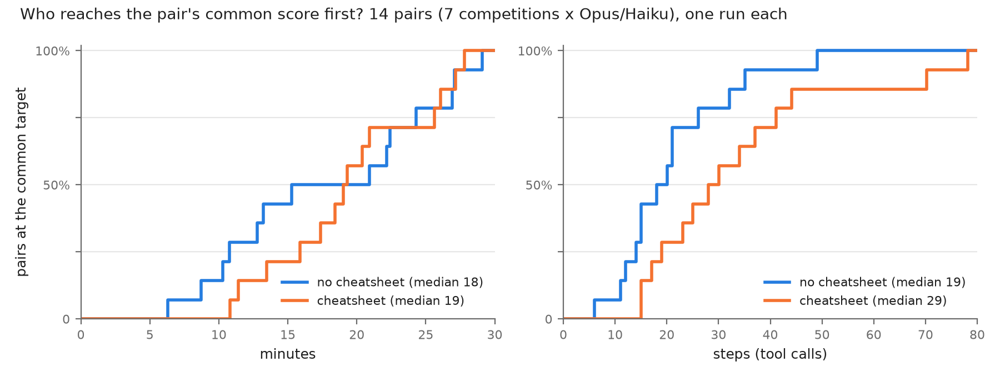
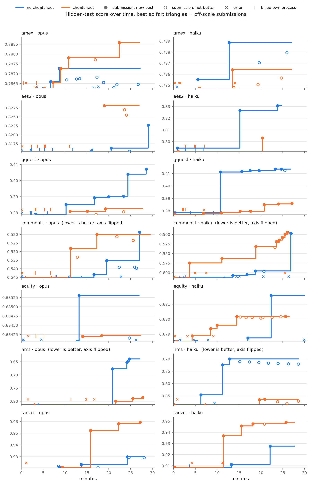

# Does the cheatsheet cut detours in from-scratch runs? (Nov 26, existing runs only)

**Question (team todo, end-to-end experiment):** does an agent with the cheatsheet take fewer detours, and so reach
a given score in fewer steps, than the same agent without it?

**Data.** No new runs were made for this. It uses the 28 from-scratch runs that already exist:
- Claude Code with Opus 5.5 and Haiku 5.5, on 7 competitions, 30 min and 1 GPU each.
- Without the cheatsheet: tag `scratch-once-1120` (Nov 20).
- With the cheatsheet: tag `scratch-mem-1125` (Nov 25). The cheatsheet is Yaqing's leave-one-out memory for that
  competition (`memory_leave_one_out/<comp>`).
- One run per cell, and no grader for the agent.

Every `submission.csv` the agent wrote was graded afterwards on the hidden test split (`trajectory.jsonl`). The agent
never saw those scores.

## Files

| file | what |
|---|---|
| `src/scratch_detours.py` | per run, from the transcripts and graded snapshots: steps, errors, killed processes, cheatsheet reads, submissions, time and steps to the pair's common target; writes `runs.csv`, `series.json` and `timelines/` |
| `src/scratch_detours_plot.py` | the two figures (run with the `tacit-eval` conda env, which has matplotlib) |
| `results/scratch_detours/runs.csv` | the numbers, one row per run |
| `results/scratch_detours/detours.json` | the detours read from each timeline (kind, minutes lost, cheatsheet-related or not) |
| `results/scratch_detours/timelines/*.md` | each run's narration, errors, kills, cheatsheet reads and graded submissions, in time order |
| `results/scratch_detours/time_to_target.png`, `pairs.png` | figures |

Definitions:
- **Step:** one tool call.
- **Error:** a tool result marked as an error, or one whose output contains a Python traceback, CUDA OOM or
  `Killed`.
- **Kill:** the agent stops one of its own processes.
- **Pair's common target:** the worse of the two runs' best hidden scores. Both runs reach it by construction, so the
  only question is who gets there first.

## Short answer

**No, not in these runs.** With the cheatsheet the agents did lose somewhat fewer minutes to detours (99 vs 126 in
total), but:
- they did not reach a given score sooner;
- almost none of their detours, avoided or taken, trace back to what the cheatsheet says;
- the comparison is confounded by GPU type.

## 1. Who reaches the same score first (the figure in the team's sketch)

For each (competition, model) pair the target is the worse of the two runs' best hidden scores. The curve is the
share of the 14 pairs whose run has already reached that target.

| | median minutes to target | median steps to target | pairs where cheatsheet got there first |
|---|---|---|---|
| all 14 pairs | 18 (no) vs 19 (cheatsheet) | 19 vs 29 | 5 of 14 by minutes, 3 of 14 by steps |
| Opus (7) | 20.9 vs 18.4 | 15 vs 19 | 3 of 7 by minutes |
| Haiku (7) | 15.2 vs 20.9 | 21 vs 41 | 2 of 7 by minutes |

The cheatsheet curve is not above the other one. In steps it is clearly below, because the Haiku cheatsheet runs used
many more tool calls (392 vs 235 in total).

## 2. Detours

**How the detours were coded.** Four Claude subagents read the 28 timelines, one or two competitions each, with one
definition: work that did not feed the run's best result and was abandoned, redone or reverted. The kinds are
`own_bug`, `env`, `resource` (OOM, too slow, killed), `dead_end` (tried, no better, dropped),
`shipped_regression` (wrote a submission worse than an earlier one, which the agent could not know) and `other`.
I spot-checked one claim from each group against the raw transcripts. The result is in
`results/scratch_detours/detours.json`.

Minutes lost to detours. Shipped regressions are left out of the totals because the groups logged their minutes
differently.

| pair | GPU no -> cheatsheet | minutes lost, no / cheatsheet | reached target (min), no / cheatsheet | best hidden score, no / cheatsheet |
|---|---|---|---|---|
| amex opus | L40 -> A6000 | 7.8 / 3.0 | 8.7 / 10.8 | 0.7873 / 0.7886 |
| amex haiku | A100-40G -> L40 | 0.6 / 0.5 | 12.7 / 13.5 | 0.7889 / 0.7864 |
| aes2 opus | A6000 -> A6000 | 11.4 / 8.9 | 29.0 / 19.0 | 0.8227 / 0.8281 |
| aes2 haiku | 6000 Ada -> L40 | 12.0 / 16.6 | 15.2 / 20.3 | 0.8306 / 0.8031 |
| gquest opus | L40S -> A6000 | 7.1 / 10.3 | 10.2 / 19.3 | 0.4072 / 0.3824 |
| gquest haiku | A6000 -> RTX PRO 6000 | 13.9 / 5.4 | 10.7 / 27.1 | 0.4136 / 0.3861 |
| commonlit opus (lower better) | L40S -> RTX PRO 6000 | 7.5 / 7.1 | 27.1 / 17.3 | 0.5188 / 0.5200 |
| commonlit haiku (lower better) | L40S -> L40 | 16.5 / 4.5 | 26.9 / 26.1 | 0.4969 / 0.4945 |
| equity opus | 6000 Ada -> L40 | 14.9 / 11.9 | 13.2 / 18.4 | 0.6853 / 0.6842 |
| equity haiku | L40S -> RTX PRO 6000 | 15.5 / 7.0 | 22.4 / 25.6 | 0.6816 / 0.6802 |
| hms opus (lower better) | A6000 -> RTX PRO 6000 | 1.5 / 5.9 | 20.9 / 27.8 | 0.6390 / 0.7854 |
| hms haiku (lower better) | L40S -> RTX PRO 6000 | 2.5 / 12.6 | 6.3 / 20.9 | 0.6995 / 0.8637 |
| ranzcr opus | A6000 -> RTX PRO 6000 | 3.5 / 0.0 | 24.3 / 15.8 | 0.9298 / 0.9595 |
| ranzcr haiku | L40 -> RTX PRO 6000 | 11.3 / 5.6 | 22.1 / 11.4 | 0.9276 / 0.9491 |
| **total** | | **126.0 / 99.3** (Opus 53.7 / 47.1, Haiku 72.3 / 52.2) | | cheatsheet better in 5 of 14 |

What the readings show:

- **Fewer detour minutes with the cheatsheet in 8 pairs, more in 4, about equal in 2.** Most of the drop is in
  `own_bug` (25.7 -> 6.0 min). The `dead_end` minutes are unchanged (39 -> 41), and `env` (40 -> 31) and `resource`
  (20 -> 17) are about the same.
- **The difference does not trace to the cheatsheet.**
  - Of the 60 detours coded in cheatsheet runs, 2 were taken citing the cheatsheet, both on amex: a CPU LightGBM
    "different model family" that was killed as too slow, and a blending path that lowered the hidden score.
  - None was visibly avoided because of it (0 `avoided_similar`).
  - The bugs the cheatsheet runs caught faster were caught because of how the scripts were written. One example is
    printing CV per model.
- **The cheatsheet is barely read.**
  - The cheatsheet runs make 2–4 tool calls that touch it, all in the first minute or so. Mostly that is
    `taxonomy.md`, plus at most one or two attention files.
  - Several Haiku runs read only part of the taxonomy and report using nothing.
  - hms Opus reported using T.3.3, which it never opened. Its transcript shows `head -50 taxonomy.md`, a listing of
    `attention/` and 40 lines of `t-2-4`. It kept a second training stage that its own validation said was worse.
- **The largest detours are shared environment problems that the cheatsheet does not cover.**
  - The installed transformers loads DeBERTa-v3 in fp16, so training goes NaN. This hit most of the aes2, commonlit
    and gquest runs, both conditions, at 6–9 min each.
  - `ps` and `pkill` are missing in the container, which left orphaned training processes.
  - Several runs hit pandas dtype errors.

  These are worth fixing before any new runs, whatever the experiment.

## Caveats

- **Different GPUs.** The two tags ran on whatever GPU Slurm gave them (`results/scratch_detours/gpus.csv`, from
  `sacct`).
  - 8 of the 14 cheatsheet runs ran on an RTX PRO 6000 Blackwell; none of the no-cheatsheet runs did.
  - Only aes2 Opus has the same GPU in both runs.
  - A faster GPU makes every failed or discarded training run cheaper in minutes, and it can raise the score of
    image models directly. Four of the 8 pairs with fewer detour minutes had the faster GPU on the cheatsheet side,
    and both ranzcr gains did.
  - The same confound applies to the cheatsheet column on the Nov 25 from-scratch slide.
- **One run per cell.** Differences of a few minutes, or 0.001–0.003 in score, are within run-to-run variation.
- **The detours are a reading of the agents' own narration, not a measurement.** "Minutes lost" are estimates.
  Shipped regressions are judged with the hidden score, which the agent never saw.
- **"Step" is one tool call.** Steps differ a lot in cost: a 10-minute training call is one step.
